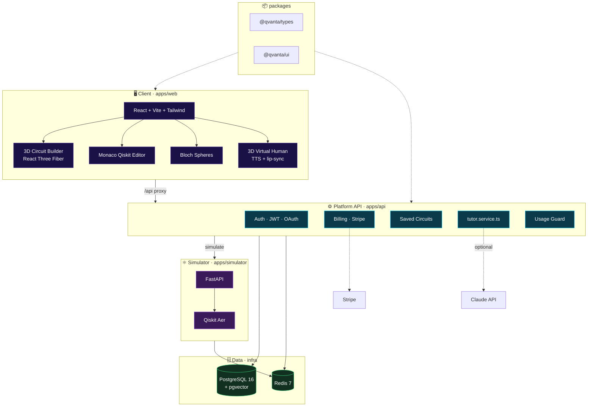
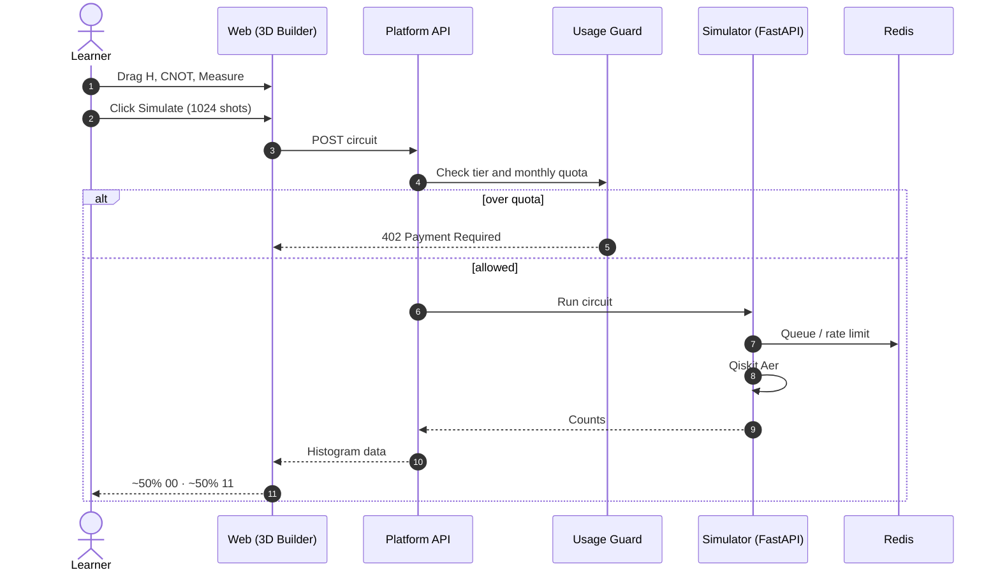
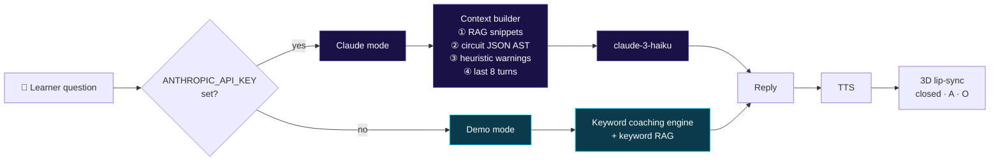

<div align="center">


# QVANTA

<sub><b>learn quantum computing by building it in 3D</b></sub>

<br/>


**A multi-tenant SaaS for interactive quantum computing education.**
Drag gates in 3D. Watch Bloch spheres move. Ask a virtual human why.

[](#-about)
[](#-about)
[](LICENSE)
[](https://gitdiagram.com/shiv0xparanoid/QVANTA)

[Features](#-features) · [Workflow](#-workflow) · [Structure](#-monorepo-structure) · [Quick Start](#-quick-start) · [Plans](#-plans) · [Checklist](#-mvp-checklist)

</div>

<br/>

## ✦ About

Quantum computing is hard to *see*. QVANTA makes circuits tangible: you build them as 3D objects, simulate them with real Qiskit Aer, and learn alongside an AI tutor that can read your circuit and tell you what's wrong with it.

Built for **early-stage students, professionals and researchers**, and developed by **Team Code Busters** for **Smart India Hackathon 2026**.

<br/>

## ✦ Features

| | Feature | What it does |
|---|---|---|
| 🧊 | **3D Circuit Builder** | Drag-and-drop gates onto qubit rails (React Three Fiber), with keyboard navigation and a 2D SVG fallback for mobile |
| ⌨️ | **Monaco Qiskit Editor** | Two-way sync with the 3D scene, with parse-error markers |
| ⚛️ | **Real Simulation** | Qiskit Aer via a FastAPI microservice, with measurement histograms (Recharts) |
| 🌐 | **Bloch Spheres** | Animated per-qubit spheres with step-through |
| 🧑‍🏫 | **Virtual Human Tutor** | 3D avatar with TTS and lip-sync visemes, and optional Claude RAG |
| 💳 | **Free / Pro tiers** | Stripe billing with usage guards |
| 🏫 | **Multi-tenant** | Role-based guards, JWT refresh, Google OAuth routes |

<br/>

## ✦ Workflow

> 🔍 **Interactive version:** open this repo on **[GitDiagram](https://gitdiagram.com/shiv0xparanoid/QVANTA)** to explore the auto-generated, clickable architecture diagram. (Swap `github.com` for `gitdiagram.com` in any repo URL.) The diagrams below are the curated versions.

### 1 · System architecture



### 2 · Simulation flow



### 3 · AI tutor, dual path



The tutor works with **zero secrets** in demo mode, so everything runs locally out of the box. Pre-flight heuristics catch missing Measure gates, self-targeting CNOTs and out-of-range qubit indices before the LLM ever sees the circuit.

<br/>

## ✦ Monorepo Structure

```
qvanta/
├── apps/
│   ├── web/            # React + Vite + Tailwind · 3D builder, Monaco, tutor
│   ├── api/            # Node + Express · auth, billing, circuits, tutor dispatch
│   └── simulator/      # Python FastAPI · Qiskit Aer + Redis
├── packages/
│   ├── types/          # shared TS types (Circuit, GateOp, TutorMessage…)
│   └── ui/             # shared React components + Tailwind preset
├── infra/
│   ├── docker-compose.yml   # Postgres 16 + pgvector, Redis 7
│   └── */Dockerfile         # api · simulator · web
└── docs/
```

<br/>

## ✦ Quick Start

> ⏱️ About 5 to 10 minutes. **Needs:** Docker + Compose, Node 20+, Python 3.11+.

```bash
# 1 · infra
docker compose -f infra/docker-compose.yml up -d

# 2 · deps
npm install

# 3 · env  (third-party keys can stay blank → demo mode)
cp apps/api/.env.example       apps/api/.env
cp apps/web/.env.example       apps/web/.env
cp apps/simulator/.env.example apps/simulator/.env

# 4 · database
npm --workspace api run prisma:generate
npm --workspace api run prisma:migrate
```

Then run each service in its own terminal:

```bash
# simulator
cd apps/simulator && python -m venv .venv && source .venv/bin/activate
pip install -r requirements.txt
uvicorn app.main:app --reload --host 0.0.0.0 --port 8000

# platform API  →  http://localhost:3000
npm --workspace api run dev

# web  →  http://localhost:5173
npm --workspace web run dev
```

<details>
<summary><b>🧪 Smoke test the happy path</b></summary>

<br/>

1. Register a local email/password user (no OAuth needed in dev)
2. Open **Circuit Builder** → drag `H` onto q0, `CNOT(q0→q1)`, then `Measure` on both → **Simulate**
3. The Bell histogram should show ~50% `00` and ~50% `11`
4. Open **AI Tutor** → ask *"What does H do?"* → the reply mentions *superposition*, the avatar speaks, and history persists on refresh
5. **Billing** shows the Free tier, and Upgrade opens a Stripe test checkout

</details>

<details>
<summary><b>🔑 Demo mode</b></summary>

<br/>

The platform boots without `GOOGLE_*`, `STRIPE_*` or `ANTHROPIC_API_KEY`. Stripe buttons are still present, and the tutor falls back to the keyword engine. If the simulator isn't running, the API still starts and simulate requests return a clean `503` in the UI.

</details>

<br/>

## ✦ Plans

| Tier | Sims / month | Max shots | Builder | Tutor | Extras |
|---|---|---|---|---|---|
| 🆓 **Free** | 50 | 1,024 | 3D + 2D | Demo mode | — |
| ⚡ **Pro** | Unlimited | 65,536 | 3D + 2D | Claude RAG | — |
| 🏫 **Institution** | Per seat | 65,536 | 3D + 2D | Claude RAG | Classroom dashboard |

<br/>

## ✦ MVP Checklist

- [x] Monorepo with `apps/{web,api,simulator}`, `packages/{ui,types}`, `infra/`
- [x] Register / login, Google OAuth routes, JWT refresh, role-based guards
- [x] 3D drag-drop builder with qubit rails, gate snap, keyboard nav, 2D fallback
- [x] Monaco ↔ 3D scene sync with parse-error markers
- [x] Bell circuit simulation with Recharts histogram
- [x] Tutor with TTS, lip-sync and persistent history
- [x] Stripe Free/Pro tiers, webhook → tier, usage guard returns 402 at cap
- [x] Per-qubit Bloch spheres with step-through animation
- [x] Mobile-responsive sidebar and Lite 2D toggle
- [x] `types`/`ui` build, `api` typecheck and `web` build all pass

<br/>

## ✦ Roadmap

- [ ] Instructor classroom dashboard
- [ ] More simulator backends (PennyLane, Cirq)
- [ ] Org-scoped tenant isolation hardening
- [ ] Deeper algorithm modules (Grover, QFT, VQE)

<br/>

<div align="center">

Built by **[Shivang](https://github.com/shiv0xparanoid)** · Team **Code Busters** · SIH 2026

<sub>If QVANTA helped you see a qubit for the first time, drop a ⭐</sub>


</div>
